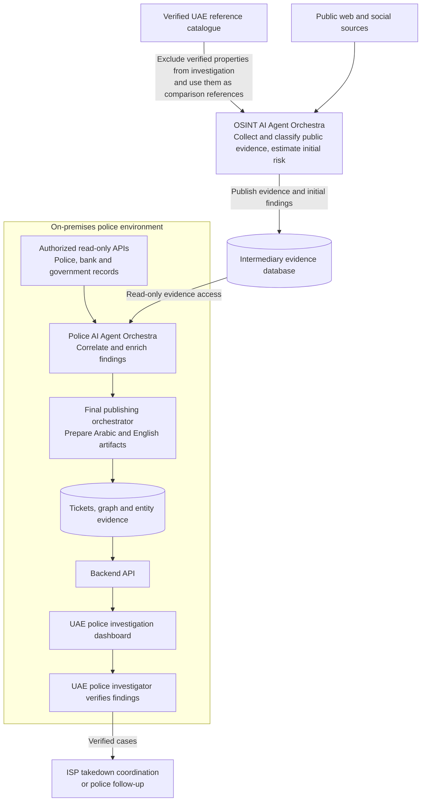

# MANAA | مناعة

**Autonomous AI cybercrime intelligence for UAE police.** MANAA is designed to help police investigators in the UAE uncover fraud schemes in days instead of weeks using agentic AI.

## The problem and solution

UAE police investigators have to find suspicious links, preserve public evidence, and cross-reference it with authorized records. That work takes time. By the time police investigators connect the evidence, a fraudulent page may already have reached victims or reappeared under a different domain.

**Fraud is a hydra. MANAA is designed to spot each new head as it grows and give police the evidence to cut it off early.** The proposed platform monitors fraud continuously and brings suspicious links, related entities, and their supporting records into one workspace. UAE police investigators verify the findings and decide whether to coordinate a takedown with local providers such as du or Etisalat, or pursue further action through established procedures.

## Architecture

MANAA follows the Unix pipeline philosophy. Each stage publishes evidence and findings in a form the next stage can consume. Persisted artifacts let UAE police investigators trace a conclusion back to the original evidence.



1. **OSINT AI Agent Orchestra.** Internet-facing specialists use crawling, public-source analysis, data processing, and local classification models to collect evidence and estimate initial risk. They publish findings, reasons, timestamps, and source references to an intermediary database.
2. **Police AI Agent Orchestra.** The on-premises fabric runs without public internet access or upstream write or control access. It reads the intermediary evidence and cross-references it with authorized read-only police, banking, and government APIs for records about people and entities relevant to the case.
3. **Final publication.** Enriched findings become tickets, graph relationships, and entity evidence reports. A final translation pass produces paired Arabic and English artifacts while preserving people’s and companies’ names verbatim from their sources. The backend serves the published records through REST and streams updates to the dashboard.
4. **UAE police review.** UAE police investigators verify the evidence, follow relationships across campaigns, and decide what action to take.

The team’s planned **UAE reference catalogue** will cover verified web properties for government services and affiliates, police and defence organizations, major UAE companies such as ADNOC, banks and exchanges such as Lari, and telecom providers. Those verified properties are excluded as investigation targets and used as trusted comparison references. For example, a verified TAMM site can serve as the reference when analysts review a suspected lookalike.

See the [agent-fabric architecture](docs/AGENT-FABRIC-ARCHITECTURE.md) and the [REST/SSE contract](docs/FRONTEND-BACKEND-CONTRACT.md).

## MVP and technical choices

The MVP is a working web application backed by a **scripted, fictional scenario**. It replays four cases through the same API contract intended for the production engine. The cases cover a TAMM lookalike, a fake recruitment ad, a marketplace seller, and a recovery listing. The replay includes a synthetic record representing one assumed-authorized police API. The live AI agent orchestras, continuous real-world scanning, and restricted integrations are proposed. Days instead of weeks is the product objective.

| Part | Implementation |
| --- | --- |
| UAE police investigation dashboard | Next.js, TypeScript, shadcn/ui, and React Flow for the relationship graph. The workspace supports English and Arabic with right-to-left layout. |
| Demo API and storage | Hono on Node.js, SQLite, versioned REST endpoints, and server-sent events (SSE) for incremental updates. |
| Demo data | Python-generated fixtures with paired Arabic and English reports, evidence references, and source-recorded names. |
| Workspace tooling | npm workspaces and Turborepo. |

See the [fictional casebook](docs/FICTIONAL-CASEBOOK.md), [generated fixtures](demo/fixtures/generated/README.md), and [demo API documentation](apps/demo-api/README.md).

## Build and run

Use **Node.js 22.18 or later** and the npm version pinned in [package.json](package.json). From the root of the MANAA-AI repository:

```sh
npm ci
npm run dev
```

Open [the dashboard](http://localhost:3000) and select **Run scan**. The same command starts the demo API at `http://127.0.0.1:4787/api/v1`. Browse the graph and tickets as evidence arrives, or switch between Arabic and English.

By default, SQLite stores the demo workspace in memory. Refreshing the page keeps the current run, and restarting the backend starts a new workspace. To reset the running demo, run the following and reload the dashboard:

```sh
curl -X POST http://127.0.0.1:4787/api/v1/demo/reset
```

To build and run the workspace checks:

```sh
npm run build
npm run lint
npm run typecheck
npm test
```

To run the dashboard against another compatible API, set `MANAA_API_ORIGIN` and run `npm run dev --workspace=web`.

## Hackathon submission

Submit the [MANAA-AI GitHub repository](https://github.com/IsmailAlrida/MANAA-AI), including the MVP and this README, through Podium+. Include the PowerPoint presentation, the one-minute demo video, and any other requested materials. The submission brief specifies the `master` branch and a deadline of **8:00 a.m. UAE time on 25 November 2026**.

## Roadmap

- [x] Replay four fictional campaigns through REST and SSE in the bilingual ticket and graph dashboard.
- [ ] Discover a separately hosted static lookalike from the repo-owned reference catalogue alone. Save DNS, page and linked-destination evidence for review.
- [ ] Surface one real suspected impersonator for UAE police review while excluding verified official sites.
- [ ] Package the shared discovery tools and scripts with three or four cloneable ICM role templates for future specialists.
- [ ] Provision a fresh VM with a reproducible agent environment on any supported host.
- [ ] Run the discovery workflow through a backend adapter backed by one local OpenCode runtime.
- [ ] Start one container per orchestra with `npm start`. Persist findings before notifying the downstream node and resume delivery after a restart.
- [ ] Publish bilingual tickets and graph updates from the isolated police node using read-only simulated APIs, curated records and seeded transaction logs.
- [ ] Measure precision, recall and time to flag on held-out fraudulent and legitimate URLs.
- [ ] Deploy multiple nodes per layer using one repeatable recipe. Hosting platform and scheduler remain open.
- [ ] Activate specialist workflows for social ads, search results and Maps listings.
- [ ] Pilot the system at an authorized UAE police headquarters with investigators verifying findings before action.

## العربية

**مناعة منصة استخبارات سيبرانية تعتمد على وكلاء الذكاء الاصطناعي، وتهدف إلى مساعدة محققي الشرطة في دولة الإمارات على كشف عمليات الاحتيال خلال أيام بدلاً من أسابيع.** يتطلب التحقيق العثور على الروابط المشبوهة وحفظ الأدلة ومقارنتها بسجلات متفرقة. وخلال ذلك قد يصل المحتالون إلى ضحايا جدد أو يعيدون تشغيل الموقع تحت نطاق مختلف.

تتبع مناعة مبدأ خطوط المعالجة في يونكس، إذ تصبح مخرجات كل مرحلة مدخلات للمرحلة التالية:

1. **أوركسترا وكلاء الذكاء الاصطناعي للمصادر المفتوحة** تجمع الأدلة العامة من الويب ومنصات التواصل، وتعالجها بأدوات البحث والزحف ونماذج التصنيف المحلية، وتقدّر مستوى المخاطر الأولي. ثم تحفظ النتائج ومراجعها في قاعدة بيانات وسيطة.
2. **أوركسترا وكلاء الذكاء الاصطناعي للشرطة** تعمل داخل البنية التحتية للشرطة، من دون اتصال بالإنترنت العام أو صلاحيات كتابة أو تحكم في المرحلة السابقة. وتقرأ الأدلة الوسيطة وتقارنها بالسجلات ذات الصلة من خلال واجهات برمجة مصرح بها للقراءة فقط لدى الشرطة والبنوك والجهات الحكومية.
3. **مرحلة النشر** تُعد تذاكر التحقيق وعلاقات الرسم البياني وتقارير الأدلة بالعربية والإنجليزية، مع الحفاظ على أسماء الأشخاص والشركات كما وردت في المصادر. ويتحقق محقق الشرطة من الأدلة قبل اتخاذ الإجراء المناسب أو التنسيق مع مزودي خدمات الإنترنت.

يستخدم النظام دليلاً مرجعياً مخططاً للمواقع الرسمية الإماراتية، يشمل الجهات الحكومية والشرطة والمؤسسات الدفاعية والشركات والبنوك والصرافات والاتصالات. تُستبعد المواقع الرسمية الموثّقة من الاستهداف وتُستخدم للمقارنة عند التحقق من الروابط التي قد تنتحل هويتها.

**النموذج الأولي** يعرض أربع قضايا خيالية عبر واجهات REST وتحديثات SSE، ويستخدم Next.js وshadcn/ui وReact Flow في الواجهة، وHono وSQLite في الخادم التجريبي، وبيانات مولّدة باستخدام Python. يحاكي العرض سجلاً واحداً من واجهة مقيدة مفترضة. يظل الفحص الحي والتكامل مع الأنظمة المقيدة جزءاً من التصميم المقترح.

**التشغيل والبناء.** من جذر المستودع، استخدم Node.js 22.18 أو أحدث، ثم نفّذ `npm ci` و`npm run dev`. افتح [لوحة التحقيق](http://localhost:3000) واضغط **تشغيل الفحص**. استخدم `npm run build` لبناء المشروع.

### خارطة الطريق

- [x] عرض أربع حملات خيالية عبر REST وSSE في لوحة التذاكر والعلاقات بالعربية والإنجليزية.
- [ ] اكتشاف موقع تجريبي ثابت شبيه بالموقع المرجعي ومستضاف بشكل مستقل، انطلاقاً من دليل المستودع وحده، وحفظ سجلات DNS ومحتوى الصفحة ووجهات روابطها للمراجعة.
- [ ] رصد موقع حقيقي يُشتبه في انتحاله صفة جهة محمية وعرضه على محققي الشرطة في الإمارات، مع استبعاد المواقع الرسمية الموثّقة.
- [ ] تجميع أدوات الاكتشاف المشتركة وبرامج التشغيل مع ثلاثة أو أربعة قوالب أدوار ICM قابلة للنسخ للوكلاء المتخصصين مستقبلاً.
- [ ] تجهيز آلة افتراضية جديدة ببيئة تشغيل قابلة لإعادة الإنشاء على أي مضيف مدعوم.
- [ ] تشغيل مسار الاكتشاف عبر موائم في الخادم يستخدم بيئة OpenCode محلية واحدة.
- [ ] تشغيل حاوية لكل أوركسترا بأمر `npm start`، وحفظ النتائج قبل إشعار العقدة التالية، واستئناف التسليم بعد إعادة التشغيل.
- [ ] نشر تذاكر باللغتين وتحديث شبكة العلاقات من عقدة الشرطة المعزولة باستخدام واجهات محاكاة للقراءة فقط وسجلات منتقاة ومعاملات مولّدة ببذرة ثابتة.
- [ ] قياس الدقة والاسترجاع وزمن رصد التهديد على مجموعة اختبار مستقلة من الروابط الاحتيالية والسليمة.
- [ ] نشر عدة عقد في كل طبقة بطريقة قابلة للتكرار، مع إبقاء اختيار منصة الاستضافة وأداة الجدولة مفتوحاً.
- [ ] تفعيل مسارات متخصصة لإعلانات التواصل الاجتماعي ونتائج البحث وقوائم الخرائط.
- [ ] إجراء تجربة ميدانية مصرّح بها في مقرّ للشرطة في الإمارات، يتحقق فيها المحققون من النتائج قبل اتخاذ أي إجراء.

**التسليم.** يُرفع رابط مستودع GitHub والنموذج الأولي وملف README والعرض التقديمي والفيديو التوضيحي لمدة دقيقة عبر Podium+. يحدد دليل التسليم فرع `master`، والموعد النهائي هو **الثامنة صباحاً بتوقيت الإمارات يوم 25 نوفمبر 2026**.

## Run locally

Install once from the repo root: `npm ci`. Then open http://localhost:3000 and press **Run scan**.

**Run the app** (web on :3000, API on http://127.0.0.1:4787):

```sh
npm run dev
```

This starts `apps/api`, which keeps its workspace in `apps/api/.data/api.sqlite`, so a restart resumes where you left off. Its agent adapter is currently a **stub that replays the fictional fixtures**; nothing scans anything real. To start from scratch, stop it, run the command below, then hard-refresh the browser (`Ctrl+Shift+R`, `Cmd+Shift+R` on Mac):

```sh
rm -rf apps/api/.data
```

**Run the non-persistent demo backend** instead (same scenario, in memory only, empty on every start). It uses the same port as `npm run dev`, so run one at a time:

```sh
npm run dev:demo
```

**Run a single piece:**

```sh
npm run dev --workspace=web        # web only (proxies /api/v1 to MANAA_API_ORIGIN, default http://127.0.0.1:4787)
npm run dev --workspace=api        # API only
npm run dev --workspace=demo-api   # demo backend only
```

**Checks:**

```sh
npm run lint
npm run typecheck
npm run test        # demo-api (shared backend core)
npm run build
```

Backend details: [`apps/api`](apps/api/README.md) and [`apps/demo-api`](apps/demo-api/README.md).

