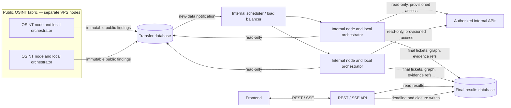

# Fraud agent-fabric architecture

**Status:** Proposed production architecture, not implemented or deployed.
**Scope:** Fraud investigation and evidence handling only. This does not propose a general-purpose surveillance platform.
**Related contracts:** [Product plan](WIZARD-OF-OZ-DEMO-PLAN.md), [frontend/backend API](FRONTEND-BACKEND-CONTRACT.md), [fictional demo casebook](FICTIONAL-CASEBOOK.md).

## Design boundary

A **node** is one autonomous agent deployment on one VPS. Each node runs its own orchestrator and may spawn multiple specialized subagents, including smaller models configured with role-appropriate tools. A **fabric** is a set of nodes with a defined trust boundary and one-way data exchange. Separate VPS host boundaries reduce the impact of a single-node compromise; they do not make compromise impossible or remove the need for monitoring and review.

There are two fabrics in the proposed fraud-only system:

- **Public OSINT fabric:** nodes have controlled public-internet access and collect authorized, publicly accessible fraud-relevant evidence. Start from a curated catalogue of important UAE organizations and their verified official domains/reference material (for example government, police, defence, companies, banks, exchanges, finance, telecoms, TAMM, and u.ae) while also discovering relevant material across public social platforms. The catalogue must be compiled and verified before production use; examples here are not a verified or exhaustive allowlist. No login circumvention, access-control bypass, malware, or broad population surveillance is in scope.
- **Internal fraud-intelligence fabric:** nodes have no route to the public internet and cannot write to or control the OSINT fabric. “Air-gapped” is shorthand for this public-network and upstream-control separation; deployments must document the actual private network isolation and allowed routes. Internal nodes automatically enrich published OSINT findings by reading the transfer database and explicitly authorized, read-only internal APIs. No operator upload or manual provider-request wait is a prerequisite. Government or banking APIs are hypothetical integration examples and only usable when the deploying organization provisions lawful access and credentials.

The arrows from the transfer database into the internal fabric carry data-availability notifications only. An acknowledgement, if required, is separate delivery metadata. It may confirm receipt or processing status but must not include task instructions or a command for an OSINT node. There is no reverse task, credential, or control channel from the internal fabric to OSINT nodes. Internal nodes may enrich and publish derived findings to the final-results database; they cannot alter upstream findings.

## Node execution and role workflows

Each VPS node owns one orchestrator responsible for that node's task intake, local workflow selection, subagent lifecycle, resource limits, and final publication. It can delegate bounded steps to specialized subagents; these are processes/tasks inside the node and are not additional VPS nodes. Scale horizontally by adding independently configured nodes and routing eligible work to them.

Each role has a dedicated workflow directory based on that role's ICM folder/catalogue. A role workflow describes a multi-step process, including its objective, allowed inputs, allowed tools, evidence/provenance requirements, scratchpad use, review/validation steps, and the final artifact schema and publish target. Scratchpads are working material, not authoritative evidence; do not publish hidden reasoning or private chain-of-thought. Publish the validated findings and concise supporting rationale needed for an operator to review them.

A final artifact must be compatible with the existing ticket and graph API contract: stable IDs, typed evidence and entities/relationships, source provenance, timestamps, support/uncertainty, and references to retrievable artifacts. Workflow-specific intermediate formats remain inside their node and do not create a new frontend domain family.

Use the smallest suitable models and tools for each bounded role when that meets quality requirements. Host internal-fabric model runtimes and tools inside the internal network; do not call public model services from nodes with no public egress. Pin/configure model and tool access per role, apply timeouts and concurrency limits, record run/tool versions, and validate output against schemas before publication. Model output can be wrong; maintain source citations and uncertainty and require human review for consequential judgments.

## Name integrity and bilingual publication

Preserve every observed person and company name verbatim through the full path: source collection, transfer storage, specialist analysis, entity linking, report composition, final translation, and publication. Do not ask an LLM or another stage to translate, reconstruct, transliterate, normalize destructively, or “correct” a name. Preserve script, spelling, punctuation, spacing, and source form as captured. Store each observed variant as a language-tagged value with its source evidence/reference and provenance. Keep stable entity IDs separate from names and aliases. Optional search/normalization keys may be derived for retrieval, but never replace or overwrite the original variants or independently prove identity.

If a source provides only one name form, retain that exact form in both published language variants; an Arabic report must not invent an Arabic name. Do not require per-stage translation. In production, only after the internal orchestrator has combined the specialist findings and completed entity linking may the final publishing step translate narrative, explanations, and headings. For the scripted demo, the equivalent final-composition step comes after the complete fixture-backed ticket has been assembled. In both backends, translation occurs once at the end, immediately before paired publication. Protect source-form names, identifiers, citations, and raw source quotations from translation or alteration. If a translated quotation is useful, label it explicitly as a translation and retain the original quotation alongside it.

Every published campaign artifact—including outputs from the scripted demo API—must contain Arabic (`ar`) and English (`en`) variants under the same stable artifact IDs and revision. Both variants must reference the same evidence, entities, relationships, citations, and underlying numbers/dates. Validate both variants and their shared references together, then publish them atomically as one ready revision. If translation or validation fails, keep the new revision incomplete and unpublished; retain the last valid bilingual revision as current. A human reviewer can compare both variants to the preserved source records.

The fixture generator and snapshots now emit paired content variants, shared IDs/citations, and source-backed name variants; keep the generated workspace as the source of truth and validate both languages before treating a revision as publishable.

## Fraud scope, graph and compiled dossiers

The production fabric filters research to fraud-relevant findings and the minimum context needed to understand those findings. It publishes findings with provenance and uncertainty; it is not a general-purpose intelligence collection system. The public OSINT and internal enrichment stages are automatic within their approved access boundaries. The checked-in demo now includes the four public campaigns plus one inert assumed-authorized police API mock record linked to a synthetic person on the job-post case. It represents automatic enrichment without calling a real API, contains no real identifiers, and includes only a synthetic residence/visa date with explicit fixture labeling. It does not assert that the person authored the post or committed wrongdoing. Replace it with a real integration only when the deploying organization provides lawful authorization and environment.

Keep one flat graph record per entity ID and connect records with evidence-cited relationships. Community membership, clustering, and outlines may help an operator navigate; preserve cross-community edges. A recursive graph-of-graphs is not required. Relationship strength is an AI-fabric assessment with explicit `strong`, `medium`, or `weak` level and a cited rationale. Evidence reference and edge type remain separate fields. The UI displays the supplied strength and rationale with a legend; it does not calculate strength or merge entities. A weak relationship never establishes identity.

Every entity has an AI-constructed dossier, not only people. The dossier is the entity’s **Evidence tab**—one concept, not a separate product view. Selecting it opens the Evidence tab in the central viewport in place of the graph; Back restores the exact graph pan, zoom, and selection. Tickets and entity Evidence tabs use the same report renderer. An optional Agent sidebar is on the right in English and mirrored on the left in RTL. The two primary pages remain Network and Tickets; the dossier is a selected-entity view within Network, not a third primary page.

Dossiers can include source-preserved person and organization names; for people, where authorized sources contain them, examples include photographs, EID issue/expiry, residence/visa/passport details, employment, phones, bank accounts/activity, narrative, cited public posts, and suspicious transactions. Other entity dossiers cover organizations, logs, websites, servers, URLs, communities, services, and ports as evidence supports. These are schema examples, not a request to collect every field. Mark unavailable facts explicitly unknown; never infer missing identity details. Each field, image, and claim retains source provenance, time, language, support, and uncertainty. Apply purpose limitation, scoped authorization, and retention to internal records. Names remain verbatim in both final language variants.

## One-way evidence transfer and storage

Keep two data stores distinct:

1. **Transfer database:** receives immutable, provenance-bearing public OSINT findings from OSINT nodes. Store source reference, collection/capture time, collection method, content hash where available, artifact version, and the publishing node/workflow identity. Internal-fabric identities have read-only access. OSINT identities can publish only through scoped write permissions and cannot read internal results or internal API credentials.
2. **Final-results database:** stores reusable derived investigation artifacts from internal workflows: final campaign tickets, graph entities/relationships, evidence references, revisions, and audit history. The internal fabric publishes validated outputs here. The REST/SSE API serves current results from this store. Operator deadline edits and close write-ups are API-owned writes with their own authorization/audit path; they are not commands sent back to OSINT nodes.

Separate network paths and database credentials by node role. Enforce read-only access in the database and at the network boundary. Allow internal nodes to reach only the transfer database, explicitly provisioned read-only internal APIs, the final-results publication target, and required infrastructure services. Allow OSINT nodes to reach only approved public collection destinations and the transfer publication path. Do not reuse credentials across fabrics or pass internal credentials to public-facing nodes.

A scheduler/load balancer inside the internal network can consume the transfer database's ready notification and assign newly available records to internal nodes. A continuous monitor persists while the browser is disconnected. Pause is a command to the application control service, which routes it to the OSINT orchestrator: stop scheduling new collection, allow in-flight work to finish and publish, and show `Pausing` until settled. Resume is supported. Internal nodes never issue these upstream commands. No in-app toast or notification surface is added. Reuse an existing database notification, queue, scheduler, or load-balancing library when it meets the contract. Do not add a bespoke pipeline, broker, or event-history system without a demonstrated need. Keep delivery acknowledgements separate from the immutable findings and final results.

Internal APIs must be explicitly provisioned and authorized by the deploying organization, expose only required read operations, and have documented scopes, audit logs, and retention rules. Government or banking APIs are examples only where an actual deployment supplies lawful access and credentials; no such integration is assumed. UAE PASS is not a general-purpose identity lookup API and must not be treated as one.

## API and operator boundary

The frontend continues to use the existing REST/SSE contract. It does not connect to agent nodes, the transfer database, internal APIs, model providers, or workflow scratchpads. It renders dossier and relationship-strength fields supplied by the backend without deriving identity or link scores. The internal orchestrator combines cited outputs from its specialist workflows with only authorized internal-source records, creates the final tickets and graph, and publishes them to the final-results database. The API serves ticket and graph upserts and run-status metadata through the documented REST/SSE interface.

Operator changes such as proposed closing dates and ticket closure notes remain explicit API operations against final-result state. They do not alter source findings or issue instructions to OSINT nodes. Keep source facts, analysis, and operator conclusions distinguishable, and retain provenance and uncertainty across every conversion.

The demo backend replays the four public campaigns plus one inert assumed-authorized police API mock record linked to a synthetic person on the job-post case. It represents automatic enrichment without calling a real API, contains no real identifiers, and includes only a synthetic residence/visa date with explicit fixture labeling. It does not assert that the person authored the post or committed wrongdoing. Production integrations require organization-provisioned lawful authorization.

## Deployment direction

For one or many self-hosted VPSes, assign each VPS one node identity and role. Keep public OSINT hosts in an internet-facing network segment and internal hosts in a private segment without public egress. The transfer database is reachable from OSINT publication paths and internal read-only paths; the final-results database is reachable from internal publishers and the API service according to role-specific policy. Keep API ingress separate from agent workflow execution.

A DigitalOcean Droplet is only an example host. A future deployment could use separate Ubuntu LTS Droplets for public OSINT nodes, private internal nodes, and the API, with managed databases or private-network database services. Restrict inbound/outbound firewall rules to each role, use TLS for permitted service links, store secrets in a managed secret store or encrypted inventory, and centralize health/operational logs without logging credentials or unnecessary source content. This document does not prescribe a specific provider, database, queue, model framework, or deployment tool.

An optional general Ansible approach can provision role-specific hosts from reusable baseline, network-policy, runtime, release, secret-injection, and health-check roles. Keep inventories environment-specific, encrypt secrets, pin releases, validate changes, and make rollouts reversible. Reuse mature libraries and managed services where suitable; add no infrastructure or deployment code until implementation is requested and the requirements are confirmed.

## Operational limits

This architecture narrows access and reduces cross-boundary control; it does not guarantee that a host, model, database, internal API, or evidence source cannot be compromised or produce an error. Validate data at every boundary, audit reads/writes and publication provenance, monitor each node, rotate scoped credentials, and maintain a human review path before consequential action. Public records and model summaries must not be treated as proof of guilt solely because records are connected in the graph.
